# 🍽️ 맛집기행

> 지역과 메뉴로 실제 음식점을 검색하고, 지도와 관련 영상을 확인한 뒤<br>
> **마음에 드는 음식점을 개인 북마크에 저장하는 웹 기반 맛집 여행 서비스**입니다.

---

## 📌 프로젝트 개요

| 항목 | 내용 |
| --- | --- |
| 프로젝트명 | 맛집기행 |
| 프로젝트 유형 | EnjoyTrip 프론트엔드 실습 프로젝트 |
| 주요 기능 | 음식점 검색, 지도 조회, 맛집 인사이트, 관련 영상, 개인 북마크·공유, 이야기 게시판, 관광정보, 회원 관리 |
| 주요 데이터 | 카카오 장소 정보, YouTube 영상 검색, 한국관광공사 관광정보 |
| 핵심 기술 | HTML, CSS, JavaScript, ES Modules, Node.js, OpenAPI, localStorage |
| 실행 환경 | Node.js 22 이상 / 최신 웹 브라우저 |

`맛집기행`은 여행 지역에서 먹고 싶은 메뉴를 검색하고, 음식점의 위치와 외부 정보를 비교한 뒤 방문 후보를 저장하는 서비스입니다.

EnjoyTrip의 관광정보 조회와 회원 관리 기능을 바탕으로 다음 기능을 구현했습니다.

- 지역·메뉴 기반 실제 음식점 검색
- 음식점 목록과 지도 핀 연결
- 카카오맵 상세정보 및 네이버·구글·유튜브 검색 링크
- 관련 유튜브 영상 조회와 앱 내 재생
- 회원별 북마크 그룹 생성 및 음식점 저장·해제
- 북마크 목록 공유와 마이페이지 프로필·저장 현황 확인
- 이야기 게시판 작성·조회·수정·삭제, 검색 및 페이지 이동
- 검색 화면과 저장한 음식점의 새로고침 복원
- PC·모바일 반응형 화면

---

## 🖥️ 프로젝트 실행 화면

지역과 메뉴로 음식점을 찾고 목록·인사이트·지도를 한 화면에서 확인할 수 있습니다.

- 왼쪽: 검색 조건, 음식점 목록, 북마크 저장, 페이지 이동
- 가운데: 선택한 음식점 정보, 외부 검색 링크, 관련 유튜브 영상
- 오른쪽: 음식점 위치와 선택한 장소의 지도 핀

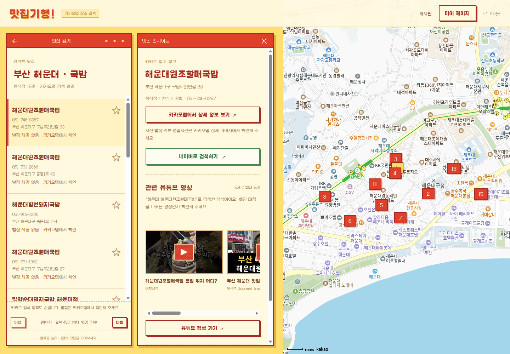

---

## ✨ 주요 기능

### 1. 회원가입 및 로그인

아이디 또는 이메일로 로그인하며, 회원정보 수정·탈퇴·비밀번호 재설정 기능을 제공합니다.

**구현 내용**

- 회원가입 입력값과 아이디·이메일 중복 검증
- salt와 PBKDF2-SHA-256을 이용한 비밀번호 해시 저장
- 로그인 유지 선택 시 30일, 미선택 시 12시간 세션 유지
- 회원정보 수정 전 비밀번호 재확인
- 이름·이메일·비밀번호 수정과 로컬 계정 비밀번호 재설정

**관련 Source**

- [js/auth.js](js/auth.js)
- [js/main.js](js/main.js)
- [js/storage.js](js/storage.js)

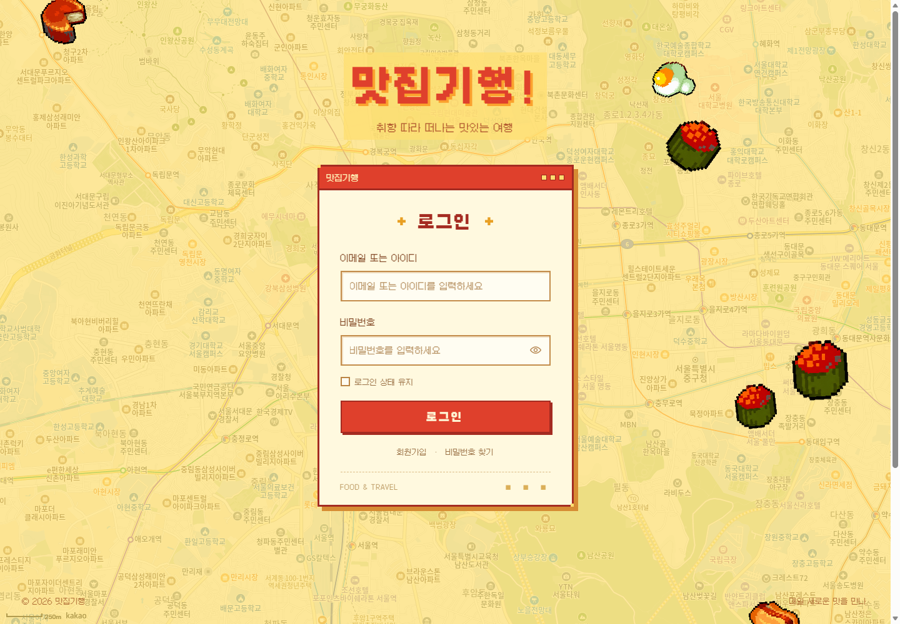

<details>
<summary>회원정보 수정 화면</summary>

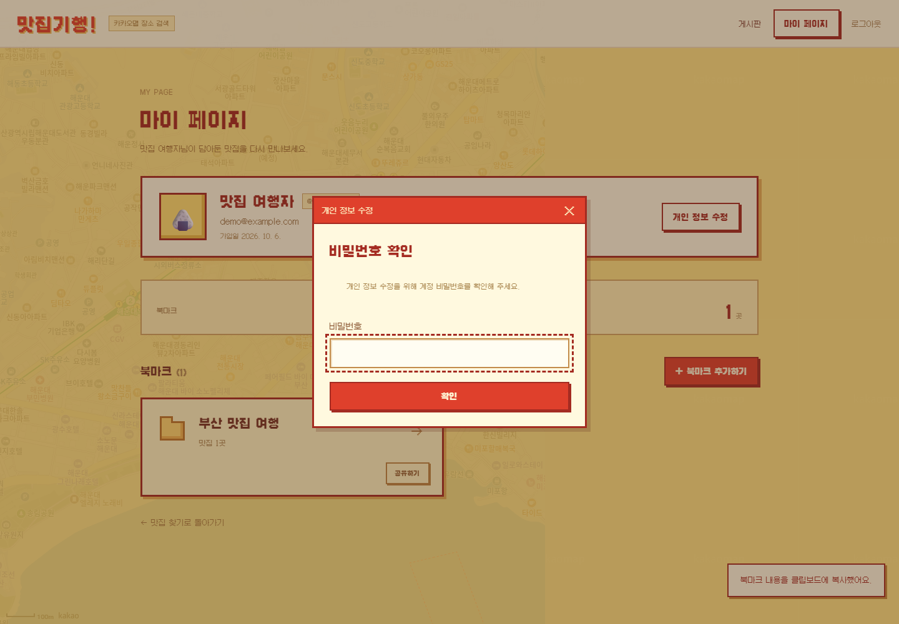

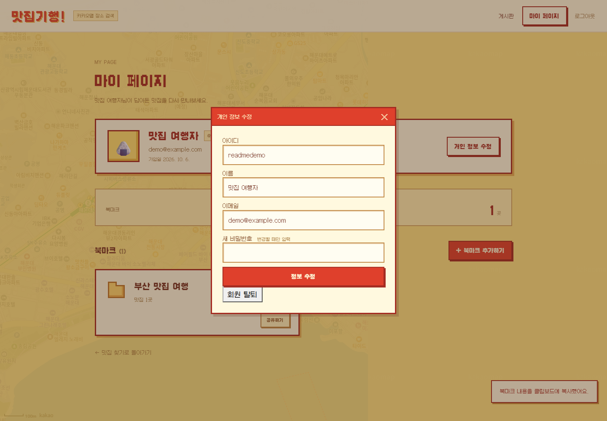

</details>

### 2. 지역·메뉴 기반 음식점 검색

지역을 입력하고 메뉴를 선택적으로 추가하면 카카오 장소 검색에서 실제 음식점을 조회합니다.

**구현 내용**

- 지역 필수 입력, 메뉴 미입력 시 지역 음식점 검색
- 카카오 Places 키워드 검색과 음식점 카테고리 FD6 적용
- 페이지당 15곳, 최대 3페이지·45곳 조회
- 장소 ID 기준 중복 제거와 좌표 검증
- 검색 조건·페이지 저장 및 새로고침 시 재조회
- 로딩·빈 결과·오류 안내와 재시도

**관련 Source**

- [js/restaurant-api.js](js/restaurant-api.js)
- [js/restaurant-app.js](js/restaurant-app.js)
- [js/restaurant-store.js](js/restaurant-store.js)

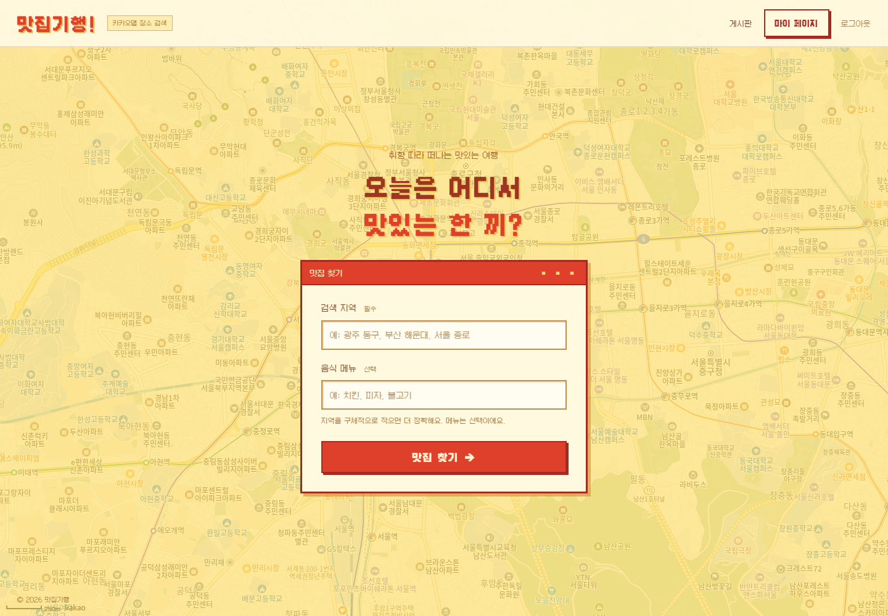

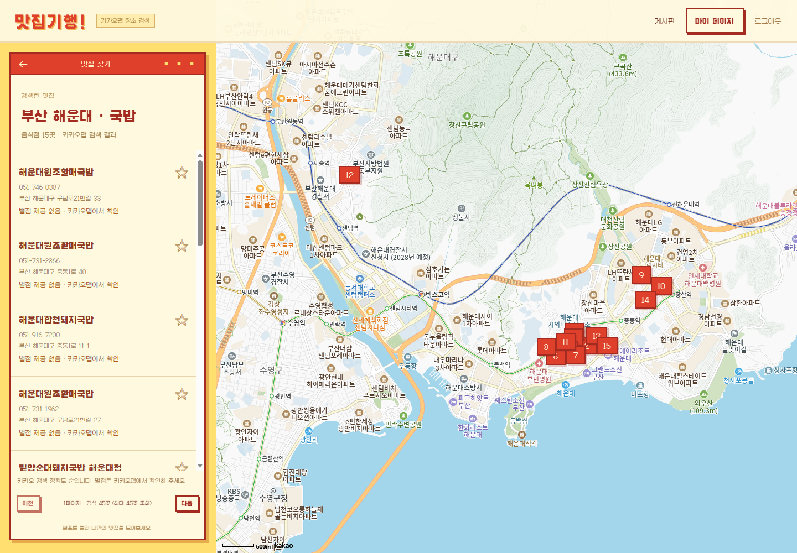

### 3. 음식점 정보와 지도 연동

음식점 목록이나 지도 핀을 선택하면 인사이트 패널과 지도 위치가 함께 변경됩니다.

**구현 내용**

- 음식점 이름·주소·전화번호·카테고리 표시
- 검색 결과 좌표를 지도 핀에 반영
- 선택한 장소 강조와 지도 이동
- 카카오맵 상세 페이지에서 사진·별점·리뷰·영업시간 확인

**관련 Source**

- [js/kakao-sdk.js](js/kakao-sdk.js)
- [js/restaurant-api.js](js/restaurant-api.js)
- [js/restaurant-app.js](js/restaurant-app.js)

### 4. 맛집 인사이트 및 외부 검색

선택한 음식점의 카카오맵 상세 페이지와 네이버·유튜브·구글 검색으로 연결합니다.

**구현 내용**

- 카카오 장소 ID에 대응하는 상세 페이지 연결
- 지역명과 가게 이름으로 검색어 구성
- 도로명·번지를 제외한 검색어 사용
- 북마크에서 연 음식점에도 동일한 검색어 적용
- 외부 검색 링크는 API 키 없이 이용

**관련 Source**

- [js/restaurant-search.js](js/restaurant-search.js)
- [js/restaurant-app.js](js/restaurant-app.js)


### 5. 유튜브 영상 조회 및 재생

음식점과 관련된 영상의 썸네일·제목·채널을 표시하며, 영상 카드를 누르면 앱 안에서 재생창이 열립니다.

**구현 내용**

- YouTube Data API v3를 서버에서 호출
- 임베드 가능한 영상 최대 5개 조회
- 영상 목록 가로 스크롤
- 동일 요청 공유와 결과 1시간 메모리 캐시
- 음식점 변경 시 이전 요청 취소와 늦은 응답 반영 방지
- 창 닫기·음식점 변경·화면 이동 시 플레이어 해제

**관련 Source**

- [js/youtube-api.js](js/youtube-api.js)
- [server/youtube.js](server/youtube.js)
- [js/restaurant-app.js](js/restaurant-app.js)

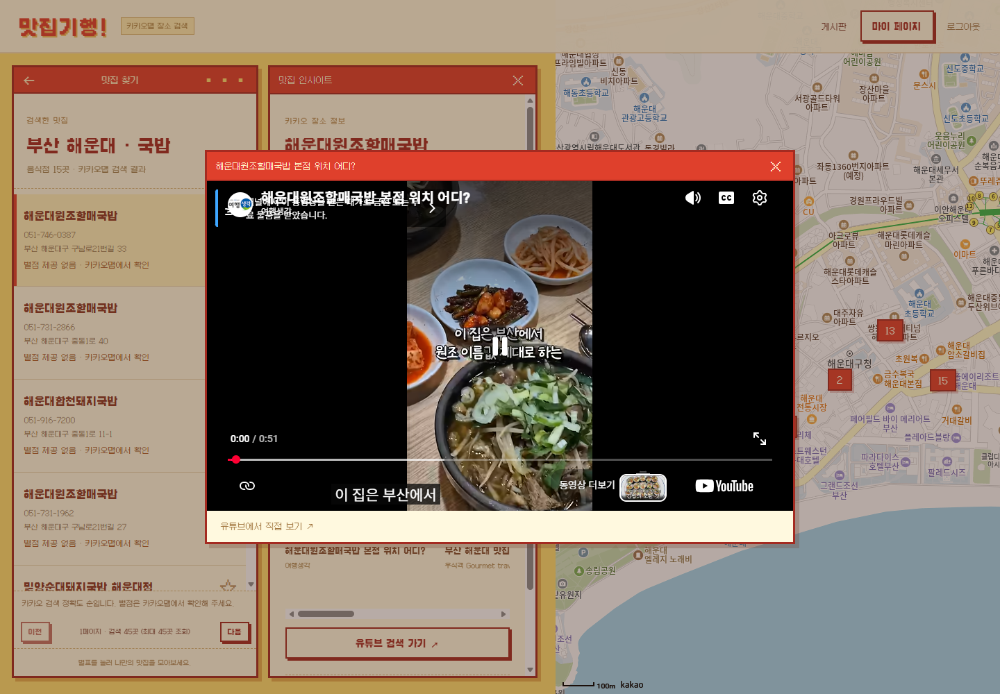

### 6. 개인 북마크 저장 및 공유

음식점의 별표를 눌러 북마크 그룹에 저장하고, 마이페이지에서 모아 둔 음식점과 회원정보를 확인할 수 있습니다.

**구현 내용**

- 회원별 북마크 분리와 그룹 이름 1~40자·중복 검증
- 하나의 음식점을 여러 그룹에 저장·해제
- 같은 그룹의 중복 저장 방지와 장소 정보 누적 저장
- 마이페이지에 프로필·가입일·북마크 수·중복 제외 음식점 수 표시
- 저장한 음식점의 상세정보와 지도 위치 재조회
- 그룹 이름·음식점 목록을 공유하고, 공유 API 미지원 시 클립보드 복사
- 회원 탈퇴 시 해당 회원의 북마크 삭제

**관련 Source**

- [js/restaurant-store.js](js/restaurant-store.js)
- [js/restaurant-app.js](js/restaurant-app.js)
- [js/auth.js](js/auth.js)

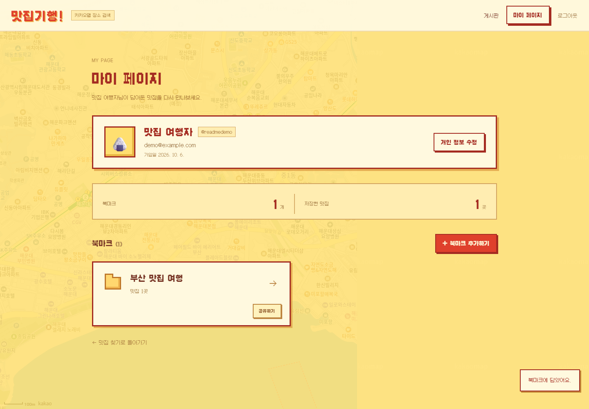

<details>
<summary>북마크 생성·저장·공유 화면</summary>

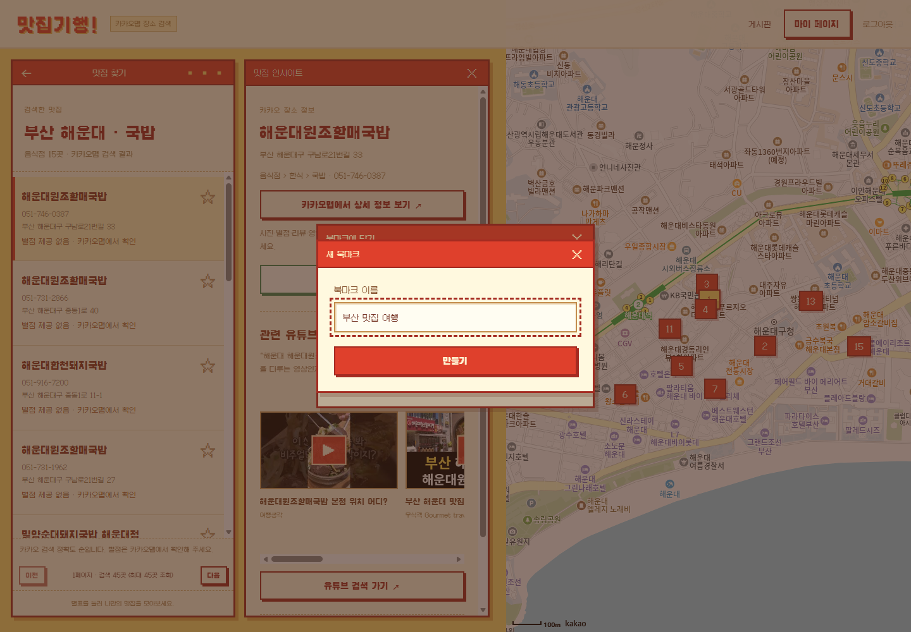

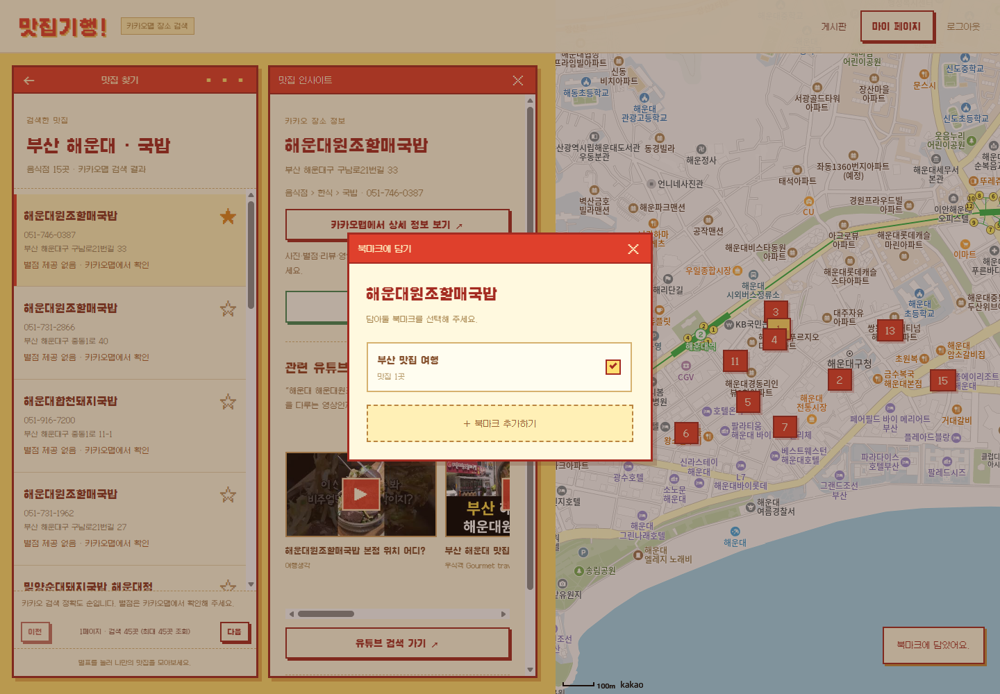

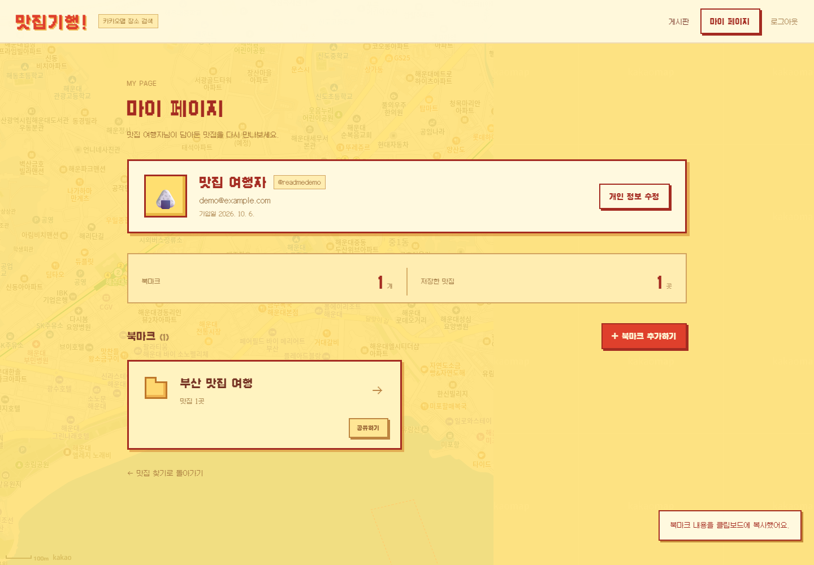

</details>

### 7. 이야기 게시판

맛집 검색 화면의 게시판 메뉴에서 식사 경험과 여행 이야기를 기록할 수 있습니다.

**구현 내용**

- 게시글 작성·상세 조회·수정·삭제와 삭제 확인창
- 최신 글 순 목록과 페이지당 8개 표시
- 제목·작성자·내용 검색 및 검색 결과 수 표시
- 상세 조회 시 조회수 증가, 작성일·작성자 표시
- 제목 120자, 작성자 40자, 내용 10,000자 제한과 필수 입력 검증
- 로그인한 회원 이름을 작성자 초기값으로 사용
- 기존 boards 저장 형식 유지와 다른 탭의 변경 시 목록 갱신
- 잘못된 주소·삭제된 글·저장소 오류 안내

**관련 Source**

- [board/list.html](board/list.html)
- [board/write.html](board/write.html)
- [board/view.html](board/view.html)
- [board/modify.html](board/modify.html)
- [js/board.js](js/board.js)
- [js/board-store.js](js/board-store.js)

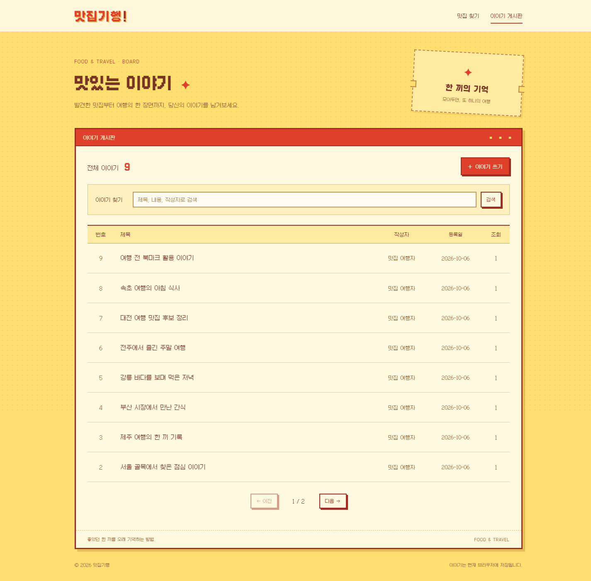

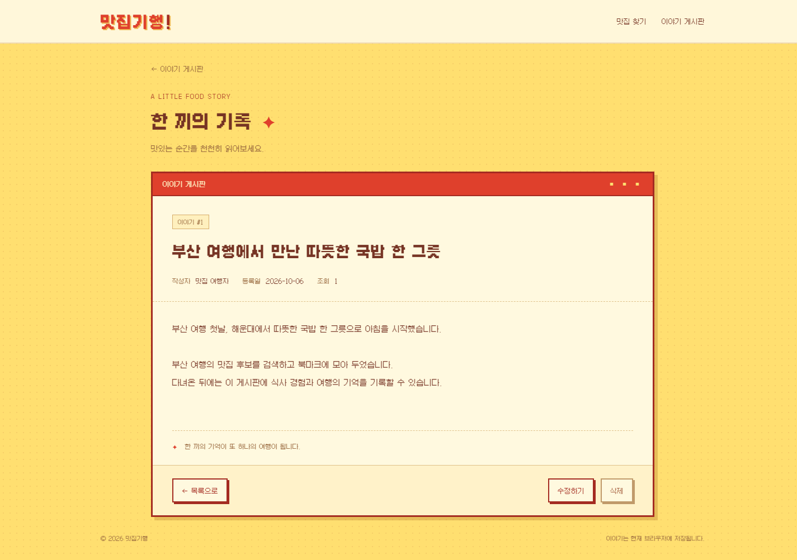

<details>
<summary>글쓰기·검색·수정·삭제·페이지 이동 화면</summary>


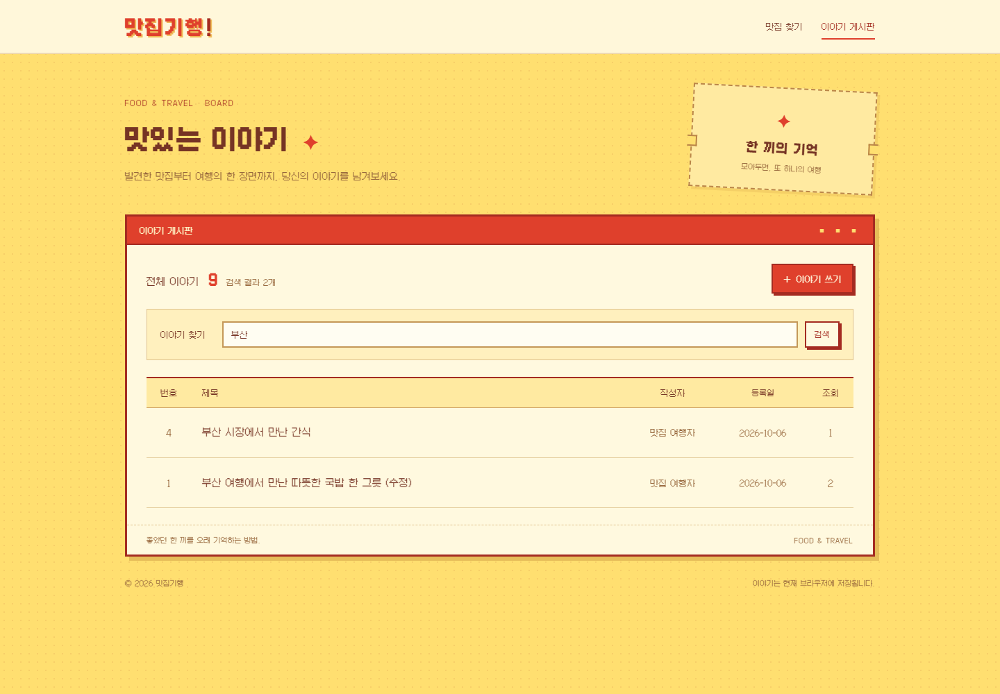

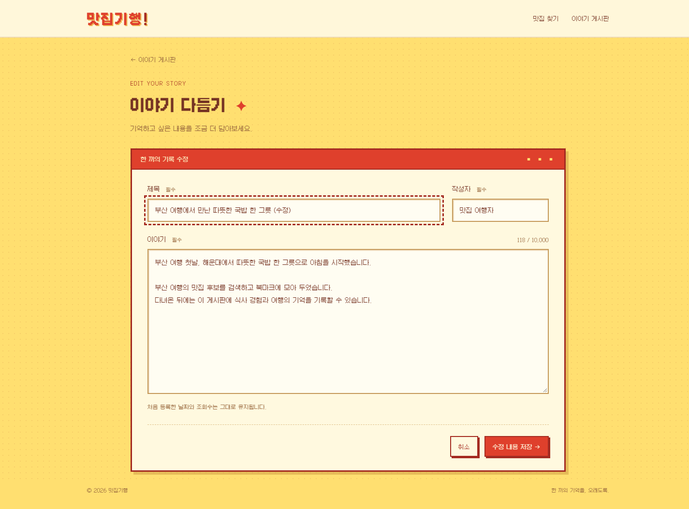

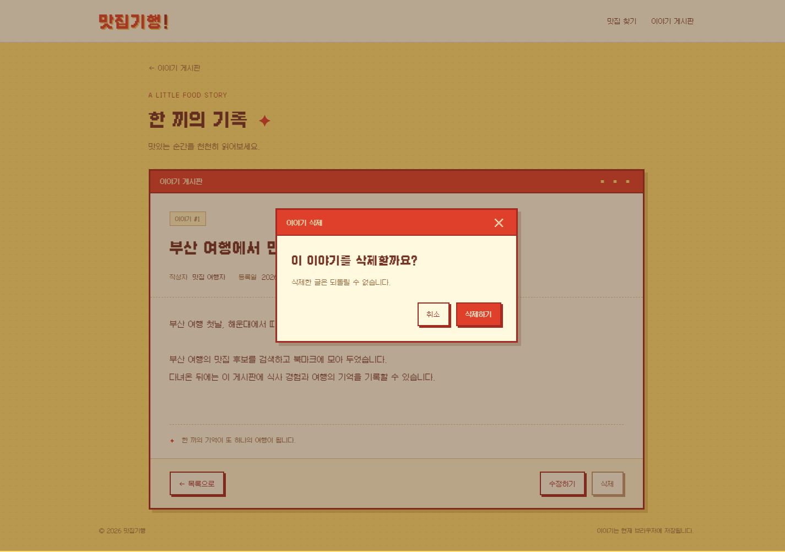

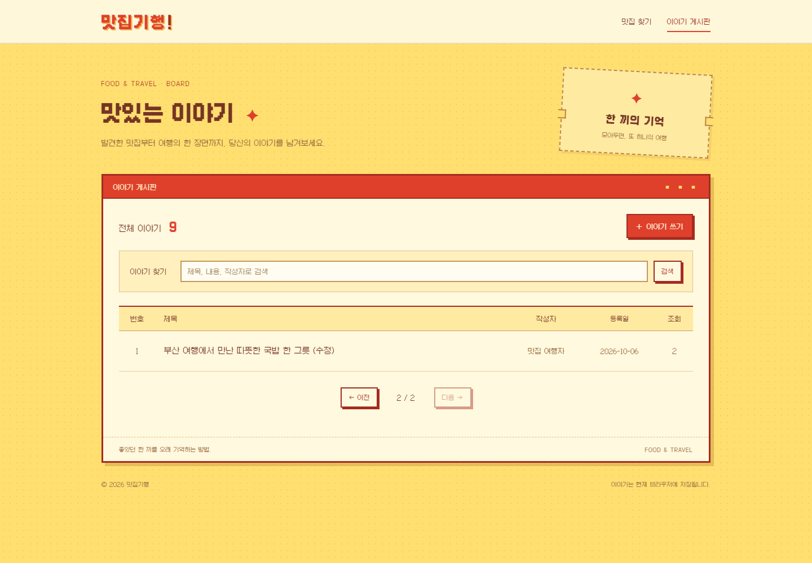

</details>

### 8. 지역별 관광정보 조회

시도·시군구·콘텐츠 유형과 키워드로 관광정보 목록과 상세정보를 조회합니다.

**구현 내용**

- 관광지·문화시설·행사·여행코스·레포츠·숙박·쇼핑·음식점 조회
- 지역·키워드 검색, 페이지 이동과 상세정보 조회
- 한국관광공사 TourAPI KorService2 서버 중계
- 실제 API 모드와 가상 데이터 기반 샘플 모드 선택
- 실제 API 오류 안내와 샘플 자동 대체 방지

**관련 Source**

- [js/api.js](js/api.js)
- [js/main.js](js/main.js)
- [js/data.js](js/data.js)
- [js/map.js](js/map.js)
- [server/tour.js](server/tour.js)

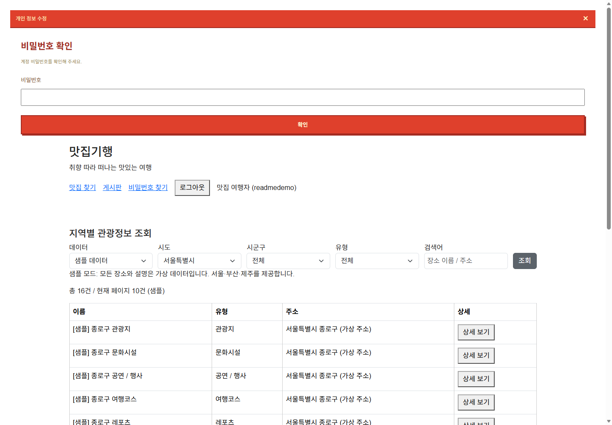

---

## 🎨 UI 구성

노랑·빨강 색상과 픽셀 그래픽을 사용해 음식 여행 서비스의 화면을 구성했습니다.

- Galmuri11 로컬 폰트와 픽셀 테두리
- 로그인 화면의 지도 배경과 드래그 가능한 음식 그래픽
- PC의 음식점 목록·인사이트·지도 동시 표시
- 모바일 화면의 정보 패널과 영상 카드 가로 스크롤
- 비밀번호 확인·회원정보 수정·북마크 생성·영상 재생 대화상자
- 검색·영상 조회의 로딩·빈 결과·오류 상태 표시

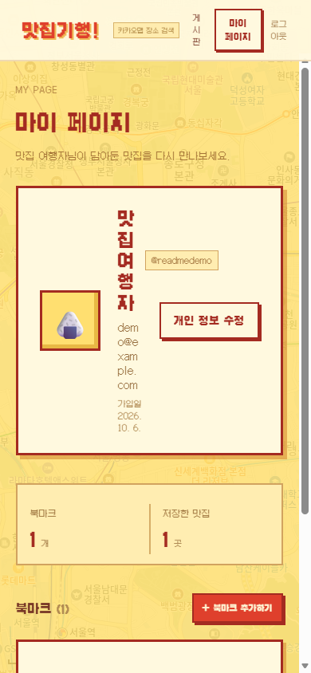
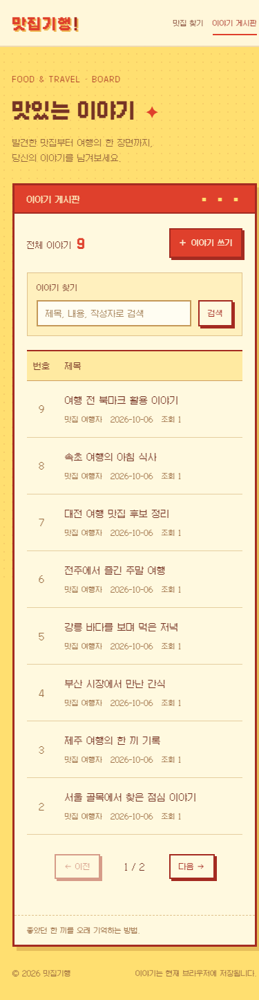

---

## 🏗️ 시스템 구조

```text
브라우저 (HTML / CSS / JavaScript)
  │
  ├─ 회원·세션·북마크·게시글 ──── localStorage
  │
  ├─ 음식점 검색·지도 ────────── Kakao Maps SDK + Places
  │
  └─ 영상·관광정보 요청
          │
          ▼
     Node.js 서버 (server.mjs)
          │
          ├─ server/youtube.js ─────────── YouTube Data API v3
          └─ server/tour.js ────────────── 한국관광공사 TourAPI
```

카카오 JavaScript 키는 지도 SDK 실행을 위해 브라우저에 전달합니다. 유튜브·Google 이미지·관광정보 서비스 키는 서버에서만 사용하며, 환경변수 파일과 서버 소스는 정적 제공 대상에서 제외합니다.

---

## 📂 프로젝트 구조

```text
EnjoyTrip_FrontEnd/
├── index.html                 # 화면과 대화상자
├── css/                       # 공통·로그인·음식점 화면 스타일
├── js/
│   ├── main.js                # 화면 이동, 회원·관광정보 UI
│   ├── auth.js                # 로컬 회원·세션·비밀번호 확인
│   ├── board.js               # 게시판 목록·검색·상세·편집 UI
│   ├── board-store.js         # 게시글 검증·저장·조회수 관리
│   ├── login-scene.js         # 음식 픽셀 배경
│   ├── restaurant-app.js      # 검색·지도·인사이트·북마크 UI
│   ├── restaurant-api.js      # 카카오 장소 검색·응답 정규화
│   ├── restaurant-store.js    # 장소 카탈로그·회원별 북마크
│   ├── restaurant-search.js   # 지역·가게 이름 검색어 구성
│   ├── restaurant-images.js   # 이전 이미지 요청 모듈 (현재 UI 미사용)
│   ├── youtube-api.js         # 영상 검색 요청
│   └── kakao-sdk.js           # 지도 SDK 공유 로더
├── server.mjs                 # 정적 서버·API 라우팅
├── server/
│   ├── tour.js                # 관광정보 API 중계
│   ├── youtube.js             # 영상 검색·캐시
│   └── restaurant-images.js   # 이전 이미지 검색 API·캐시 (현재 UI 미사용)
├── tests/                     # 자동 검사
├── docs/                      # 기획·화면·테스트 문서와 캡처
├── resources/                 # 이미지·폰트
├── 01_api/                    # 기존 API 참고 자료
├── board/                     # 이야기 게시판 목록·상세·작성·수정
└── .env.example               # 환경변수 예제
```

`board/`는 맛집기행의 픽셀 스타일을 적용한 이야기 게시판입니다. 맛집 검색 화면의 게시판 메뉴 또는 `/board/list.html`에서 열 수 있습니다. 기존 `boards` localStorage 데이터를 유지하며, 글 작성·조회·수정·삭제, 검색과 페이지 이동을 제공합니다. 게시글은 같은 브라우저·접속 주소에만 저장되며 서버 공유나 작성자 권한 검사는 제공하지 않습니다.
---

## 🔄 서비스 동작 흐름

```text
회원가입 및 로그인
    ↓
지역·메뉴 입력
    ↓
카카오 음식점 검색
    ↓
음식점 목록과 지도 핀 표시
    ↓
목록 또는 지도에서 음식점 선택
    ↓
장소 정보·외부 검색·관련 영상 확인
    ↓
북마크 그룹에 저장
    ↓
마이페이지에서 북마크 선택
    ↓
저장한 음식점 재조회
```

| 화면 | 주소 |
| --- | --- |
| 로그인 | `/#login` |
| 회원가입 | `/#join` |
| 비밀번호 재설정 | `/#reset` |
| 지역·메뉴 검색 | `/#home` |
| 음식점 목록·인사이트 | `/#results` |
| 내 북마크 | `/#bookmarks` |
| 회원정보 수정 | 마이페이지의 개인 정보 수정 버튼 → 비밀번호 확인 → 수정 대화상자 |
| 관광정보 조회 | `/#tour` |
| 이야기 게시판 | `/board/list.html` |
| 게시글 작성·상세·수정 | `/board/write.html`, `/board/view.html?index=글번호`, `/board/modify.html?index=글번호` |

---

## 📋 기능 구현 현황

| 구분 | 기능 | 구현 내용 |
| --- | --- | --- |
| 관광정보 | 지역·유형별 조회 | 시도·시군구, 콘텐츠 유형, 키워드, 목록·상세 조회 |
| 회원 관리 | 가입·조회·수정·탈퇴 | 입력 검증, 중복 확인, 로컬 회원정보 저장 |
| 로그인 관리 | 로그인·로그아웃·비밀번호 재설정 | 비밀번호 해시 검증, 세션 만료, 재설정 데모 |
| 음식점 검색 | 지역·메뉴 검색 | 실제 카카오 장소 검색, 음식점 카테고리, 페이지 이동 |
| 지도 | 음식점 위치 조회 | 목록과 지도 핀 연결, 선택한 장소 정보 표시 |
| 인사이트 | 외부 정보 확인 | 카카오맵 상세 및 네이버·유튜브·구글 검색 링크 |
| 영상 | 관련 영상 조회·재생 | YouTube 검색, 영상 카드, 재생 대화상자 |
| 북마크 | 회원별 저장·재조회·공유 | 그룹 생성, 다중 그룹 저장·해제, 프로필·저장 현황, 텍스트 공유 |
| 게시판 | 이야기 작성·조회·수정·삭제 | 제목·작성자·내용 검색, 8개 단위 페이지 이동, 조회수, 로컬 저장 |
| 반응형 UI | PC·모바일 화면 | 화면 크기에 따른 목록·인사이트·영상 배치 |

---

## ⚙️ 기술 스택

| 구분 | 기술 |
| --- | --- |
| Language & UI | HTML5, CSS3, Vanilla JavaScript, ES Modules |
| Server | Node.js 22 이상, 기본 `http` 모듈 |
| Data & State | JSON, localStorage, 카카오 장소 ID 기반 카탈로그 |
| Network | Fetch API, AbortController, Kakao Maps JavaScript SDK, OpenAPI |
| Design | Galmuri11, 픽셀 그래픽, 반응형 CSS |
| Test | Node.js 기본 테스트 러너 |

별도 프레임워크나 추가 npm 패키지 없이 실행할 수 있습니다.

---

## 🌐 사용 API 및 설정

음식점 검색과 지도는 카카오 SDK를 사용한다. 영상 검색과 관광정보 실제 조회는 서버에서 외부 API를 호출한다. 이미지 검색 모듈과 서버 경로는 남아 있지만 현재 음식점 화면에서는 호출하지 않는다. 각 기능을 실행하려면 아래 환경변수를 설정해야 한다. 서버용 API 키는 `.env.example`을 복사한 `.env`에 입력합니다.

| API | 필수 여부 | 필요한 값 | 미설정 시 |
| --- | --- | --- | --- |
| Kakao Maps JavaScript SDK + Places | 음식점 검색·지도에 필수 | `KAKAO_MAP_JS_KEY` | 코드의 기본 JavaScript 키를 사용한다. 해당 앱의 도메인·권한에 따라 동작 여부가 달라진다. |
| YouTube Data API v3 | 앱 내 영상 검색에 필요, 선택 기능 | `YOUTUBE_API_KEY` | 영상 검색 오류 안내가 표시된다. 외부 유튜브 검색 링크는 사용할 수 있다. |
| Google Custom Search JSON API | 이전 이미지 검색 모듈용, 현재 화면에서 사용하지 않음 | `GOOGLE_CUSTOM_SEARCH_API_KEY`, `GOOGLE_CUSTOM_SEARCH_CX` | 현재 음식점 목록에는 사진 영역이 없다. |
| 한국관광공사 TourAPI | 관광정보 실제 모드에 필요, 선택 기능 | `TOUR_API_SERVICE_KEY` | 실제 조회는 사용할 수 없고 샘플 모드는 사용할 수 있다. |

카카오 기본 키는 `js/map-config.js`에 있다. 자신의 카카오 앱 JavaScript 키를 `.env`에 설정해 사용하는 것을 권장한다. 음식점 검색에 별도 Kakao REST 키는 필요하지 않다.

유튜브는 Google Cloud 프로젝트에서 **YouTube Data API v3를 활성화하고 API 키를 발급**하면 된다. 현재 공개 영상 검색에는 OAuth 로그인 설정이 필요하지 않다. [YouTube 공식 설정 안내](https://developers.google.com/youtube/v3/getting-started)

현재 음식점 목록에는 사진 영역이 없으며 이미지 검색 환경변수를 설정해도 사진이 표시되지 않습니다. 이미지 기능을 다시 연결하려면 화면 코드와 공급자 이용 가능 여부를 확인해야 합니다.

네이버·구글·유튜브의 **외부 검색 링크**에는 API 키가 필요하지 않다. 회원가입·로그인·북마크도 로컬 저장 방식이므로 별도 인증 API나 DB 설정은 필요하지 않다.

---

## ▶️ 실행 방법

### 1. 환경변수 준비

Node.js 22 이상을 준비한 뒤 프로젝트 폴더에서 실행한다. 기존 `.env`가 있다면 필요한 값만 수정한다.

```powershell
Copy-Item .env.example .env
```

| 변수 | 용도 | 필요한 기능 |
| --- | --- | --- |
| `PORT` | 서버 포트. 실행 명령에서 `5173` 지정 | 서버 실행 |
| `KAKAO_MAP_JS_KEY` | 카카오 앱의 JavaScript 키 | 지도·음식점 검색 |
| `YOUTUBE_API_KEY` | YouTube Data API v3 키 | 관련 영상 검색 |
| `GOOGLE_CUSTOM_SEARCH_API_KEY` | Google Custom Search API 키 | 이전 이미지 검색 모듈 (현재 UI 미사용) |
| `GOOGLE_CUSTOM_SEARCH_CX` | 이미지 검색을 켠 검색엔진 ID | 이전 이미지 검색 모듈 (현재 UI 미사용) |
| `TOUR_API_SERVICE_KEY` | 공공데이터포털 관광정보 서비스 키 | 관광정보 실제 모드 |

카카오 키는 브라우저에서 사용하는 **JavaScript 키**다. REST API 키나 Admin 키를 넣지 않는다. 나머지 서비스 키는 서버에서만 사용한다. `.env`는 커밋하지 않는다.

### 2. 카카오 도메인 등록

카카오 앱의 JavaScript SDK 도메인에 `http://localhost:5173`를 등록하고 지도 API 이용 권한을 확인한다. 브라우저 접속 주소와 등록한 도메인이 같아야 한다. 접속 주소의 호스트명과 포트가 달라지면 해당 주소도 등록한다.

유튜브 영상 검색을 사용하려면 Google Cloud에서 YouTube Data API v3를 활성화한다. 서버가 호출하므로 키 제한도 서버 환경에 맞춰 설정한다. 관광정보 키는 국문 관광정보 서비스_GW 승인 키를 사용하며 Decoding 키를 권장한다.

### 3. 서버 실행

```powershell
npm start -- --port=5173
```

[http://localhost:5173/](http://localhost:5173/)에 접속한다. HTML 파일을 직접 열거나 Live Server로 실행하면 서버 API 중계를 사용할 수 없으므로 프로젝트 서버를 이용한다.

```powershell
# 파일 변경 시 서버 자동 재시작
npm run dev -- --port=5173
```

포트를 생략하면 `.env`의 `PORT`를 사용하고, 설정이 없으면 `5173`으로 실행한다. 환경변수를 수정한 뒤에는 서버를 다시 시작한다.
---

## 🧩 핵심 모듈

| 모듈 | 역할 |
| --- | --- |
| `main.js` | 화면 이동, 회원·관광정보 이벤트 처리 |
| `board.js` | 게시판 목록·검색·페이지 이동·상세·편집 화면 제어 |
| `board-store.js` | 게시글 입력 검증, 로컬 저장, 조회수, 작성·수정·삭제 |
| `auth.js` | 로컬 회원 관리, 비밀번호 해시, 세션, 비밀번호 재확인 |
| `restaurant-app.js` | 음식점 검색·지도·인사이트·북마크 화면 제어 |
| `restaurant-api.js` | 카카오 장소 검색 및 응답 정규화 |
| `restaurant-store.js` | 장소 카탈로그, 검색 상태, 회원별 북마크 저장 |
| `restaurant-search.js` | 지역명·가게 이름 기반 검색어 구성 |
| `restaurant-images.js` | 이전 이미지 요청 모듈, 현재 음식점 UI에서 사용하지 않음 |
| `kakao-sdk.js` | 지도 SDK 로딩 및 공유 |
| `server.mjs` | 정적 파일 제공, 환경설정 응답, API 라우팅 |
| `server/youtube.js` | 영상 검색, 오류 처리, 요청 공유 및 캐시 |
| `server/restaurant-images.js` | 이전 이미지 검색 API, 오류 처리 및 캐시, 현재 UI에서 호출하지 않음 |
| `server/tour.js` | 관광 API 요청과 응답·오류 처리 |

---

## 💡 구현 시 고려한 문제

### 1. 검색 변경 후 이전 응답이 표시되는 문제

비동기 조회 중 음식점이나 화면을 바꾸면 이전 요청이 늦게 도착할 수 있습니다. 요청 취소와 요청 순서·현재 화면·회원 상태 확인을 적용해 이전 응답이 새 화면을 덮어쓰지 않도록 처리했습니다.

### 2. 다른 지역 검색 후 북마크 정보 유지

새 검색 결과로 기존 장소 정보를 교체하면 저장한 음식점을 다시 열 수 없습니다. 장소 정보를 카카오 장소 ID 기준으로 누적 저장하고 북마크에서 해당 정보를 참조하도록 구성했습니다.

### 3. 외부 API 요청 중복과 사용량

동일한 영상·이미지 검색 요청은 서버에서 공유하고 결과를 메모리에 캐시합니다. 이전 이미지 모듈에는 보이는 카드만 조회하고 동시 요청 수를 제한하는 로직이 남아 있지만 현재 음식점 화면에는 연결하지 않습니다. 실패 응답은 캐시하지 않아 재시도할 수 있습니다.

### 4. 제공되지 않는 음식점 정보

카카오 장소 검색은 사진·별점·리뷰·영업시간을 제공하지 않습니다. 음식점 사진 영역은 제거했으며 별점은 제공 없음으로 표시하고 상세 페이지로 연결합니다. 영상은 별도 검색 결과로 표시합니다.

### 5. 회원별 데이터와 회원정보 수정

북마크를 회원별로 분리하고, 마이페이지는 로그인 상태에서 열 수 있도록 구성했습니다. 회원정보 수정은 비밀번호 재확인을 거쳐 대화상자로 제공합니다. 비밀번호 변경·재로그인·세션 만료 후에는 다시 확인해야 합니다.

---

## 🧪 테스트

```powershell
npm test
```

| 테스트 파일 | 검사 대상 |
| --- | --- |
| `base.test.js` | 회원 흐름, 세션, 관광 샘플 필터, 서버 정적 제공 |
| `board.test.js` | 기존 게시글 보존, 작성·조회·수정·삭제, 입력·저장소 오류, 게시판 정적 제공 |
| `restaurant-flow.test.js` | 음식점 검색·페이지 처리, 장소 저장, 북마크 분리, 비밀번호 재확인 |
| `tour-api.test.js` | 관광 API 요청 파라미터와 인증·네트워크 오류 |
| `youtube-api.test.js` | 영상 검색, 응답 정규화, 요청 공유, 캐시, 키 비노출 |
| `restaurant-images.test.js` | 이미지 첫 결과, 설정·응답 오류, 캐시, 키 비노출 |

실제 연동은 API 키를 설정한 뒤 지역·메뉴 검색, 영상 재생, 북마크 저장·재조회, 관광정보 실제 모드를 통해 확인할 수 있습니다.

---

## ⚠️ 현재 제한 사항

- 회원·세션·북마크·게시글은 localStorage에 저장되어 같은 브라우저와 접속 주소에서만 유지됩니다. 기기·브라우저·포트 간 동기화는 제공하지 않습니다.
- 회원정보 변경 후 마이페이지 표시가 즉시 갱신되지 않으면 새로고침해 변경된 정보를 확인할 수 있습니다.
- 회원 인증 서버·DB·메일 발송·본인 인증은 구현하지 않았으며, 비밀번호 재설정은 로컬 계정 데모입니다.
- 음식점 결과는 카카오 검색 정확도 순이며, 별점·리뷰 기반 추천 순위가 아닙니다. 지역 검색어가 행정구역 경계를 엄격하게 제한하지는 않습니다.
- 북마크는 저장 당시 음식점 정보입니다. 최신 정보는 카카오맵 상세 페이지에서 확인해야 합니다.
- 관련 영상 검색 결과가 해당 매장의 공식 영상이나 방문 영상임을 보장하지 않습니다.
- 게시판은 로그인 및 작성자 권한 검사를 적용하지 않아 같은 브라우저 저장소의 게시글을 누구나 수정·삭제할 수 있습니다.
- 북마크 공유에는 브라우저의 공유·클립보드 기능과 권한이 필요하며, 공유한 내용의 가져오기나 동기화는 제공하지 않습니다.
- 외부 API 이용에는 키·권한·도메인 설정이 필요하며, 요청 한도와 제공자 상태에 따라 조회가 제한될 수 있습니다.
- 자연어·AI 추천, 리뷰 수집·요약, 여행 경로 생성·편집·저장은 구현 범위에 포함하지 않습니다.

---

## 🚀 향후 개선사항

- 서버 기반 회원 인증과 DB 저장
- 기기 간 북마크 동기화
- 게시판 서버 저장과 로그인·작성자 권한 검사
- 이용 가능한 이미지 제공 방식으로 전환
- 자연어 여행 조건 입력과 실제 음식점 데이터 기반 추천
- 선택한 음식점의 방문 순서 편집 및 여행 경로 저장
